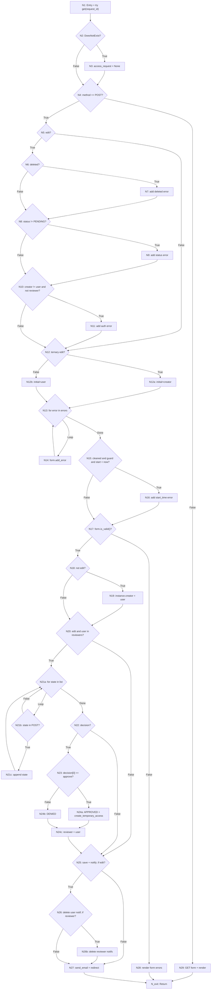

# Phase 2: SonarQube Static Analysis & Control Flow Graph Complexity

**Project:** SE3002 Software Quality Engineering Final Project (Fall 2026) — Section A  
**Area 1 Owner:** Jaweria Abdul Hameed (`24I-3025`)  
**Tool:** SonarQube Community Edition `9.9.8.100196` + `sonarsource/sonar-scanner-cli` (latest)  
**Raw Evidence:** `docs/evidence/sonarqube_baseline_metrics.json` (plus `coverage.xml` from `coverage.py 7.17.4`)

---

## 1. SonarQube Baseline Metrics Summary

Executed against baseline commit `aa5ac6e20e4e35e6f67ab7d2133b8188679ae746` with `sonar-project.properties` (`NEMO/`, `sqe_local/`, `scripts/`, excluding `NEMO/tests/**` and `NEMO/migrations/**`).

| Metric | Whole Project (`nemo-sqe-access-requests`) | `NEMO/views/access_requests.py` | `NEMO/forms.py` | `NEMO/models.py` | `NEMO/views/api.py` |
| :--- | :---: | :---: | :---: | :---: | :---: |
| **NCLOC** | 55,089 | 249 | 555 | 5,028 | 1,119 |
| **Lines / Statements** | 62,204 / 18,484 | 295 / 138 | 666 / 403 | 6,070 / 3,028 | 1,291 / 467 |
| **Functions / Classes** | 1,691 / 679 | 9 / 0 | 35 / 40 | 459 / 193 | 28 / 58 |
| **Cyclomatic Complexity (`complexity`)** | 6,003 | **51** | 120 | 1,029 | 64 |
| **Cognitive Complexity** | 6,590 | **85** | 123 | 739 | 53 |
| **Duplication (`duplicated_lines_density` / blocks)** | 2.0% (89 blocks) | **0.0%** (0 blocks) | 4.2% (2 blocks) | 0.0% (0 blocks) | 0.0% (0 blocks) |
| **Code Smells** | 407 | **6** | 4 | 37 | 2 |
| **Bugs** | 106 | **0** | 0 | 0 | 0 |
| **Vulnerabilities** | 0 | **0** | 0 | 0 | 0 |
| **Security Hotspots** | 52 | **1** | 0 | 0 | 0 |
| **Coverage (Combined / Line / Branch)** | 27.8% / 34.9% / 1.7% | **16.7% / 22.3% / 0.0%** | 30.2% / 39.4% / 0.0% | 46.2% / 55.1% / 0.8% | 69.3% / 73.9% / 13.2% |
| **Technical Debt (`sqale_index`)** | 4,432 min (~73.9 h) | **65 min** | 30 min | 239 min | 27 min |
| **Maintainability Rating** | **A** (`1.0`) | **A** (`1.0`) | **A** (`1.0`) | **A** (`1.0`) | **A** (`1.0`) |
| **Reliability Rating** | **C** (`3.0`) | **A** (`1.0`) | **A** (`1.0`) | **A** (`1.0`) | **A** (`1.0`) |
| **Security Rating** | **A** (`1.0`) | **A** (`1.0`) | **A** (`1.0`) | **A** (`1.0`) | **A** (`1.0`) |
| **Security Review Rating** | **E** (`5.0`) | **E** (`5.0`) | **A** (`1.0`) | **A** (`1.0`) | **A** (`1.0`) |

---

## 2. What Each SonarQube Metric Reveals About Quality & Risk

1. **Cyclomatic (`51`) & Cognitive Complexity (`85`) in `access_requests.py`:**  
   With only 9 functions and 249 NCLOC, `NEMO/views/access_requests.py` concentrates high branching density in `create_access_request` (Cognitive Complexity = **50**, over 3x SonarQube's limit of `15`) and `send_request_received_email` (Cognitive Complexity = **18**). High nesting of role checks, edit guards, and reviewer approval decisions elevates defect risk (`PR-02`, `PR-03`, `PR-04`) and mandates 100% branch coverage plus MCC/MC-DC unit tests in Phase 3.
2. **Duplication (`0.0%` in `access_requests.py`, `2.0%` project-wide, `4.2%` in `forms.py`):**  
   `access_requests.py` has zero copy-paste code duplication (`0` blocks), while `forms.py` shows `4.2%` duplication across sibling request forms (`AdjustmentRequestForm`, etc.). Risk from duplication in our target module is low; focus stays on logic correctness and API/form validation parity (`PR-01`).
3. **Code Smells (`6` in `access_requests.py`, `407` project-wide) & Technical Debt (`65 min` / `4,432 min`):**  
   All 6 smells in `access_requests.py` relate directly to control-flow readability and nested conditional complexity:
   - `[CRITICAL] python:S3776 (line 90)`: `create_access_request` Cognitive Complexity `50 > 15`.
   - `[CRITICAL] python:S3776 (line 199)`: `send_request_received_email` Cognitive Complexity `18 > 15`.
   - `[MAJOR] python:S3358 (lines 218, 218, 221)`: Nested ternary expressions in `send_request_received_email`.
   - `[MINOR] python:S1940 (line 111)`: `not user in access_request.reviewers()` instead of `user not in ...`.
   Maintainability Rating is **A** (`1.0`) because 65 minutes of debt over 249 NCLOC is under 5% of development cost, yet `S3776` warns that changes to `create_access_request` carry high regression risk.
4. **Bugs (`0` in module, `106` project-wide — Reliability C) & Vulnerabilities (`0` — Security A):**  
   Static rules detected 0 syntax/type bugs in `access_requests.py`, whereas project-wide bugs (largely in JS/CSS/template rules and other modules) push overall Reliability to **C**. Zero static vulnerabilities are flagged, which does **not** guarantee business-logic security (`PR-01` API bypass and `PR-05` `@require_GET` delete remain critical/high runtime risks).
5. **Security Hotspots (`1` in `access_requests.py`, `52` project-wide — Security Review E):**  
   `python:S3752` flags line 89 (`@require_http_methods(["GET", "POST"])` on `create_access_request`) with `HIGH` vulnerability probability (`csrf` category) because mixing safe (`GET`) and state-changing (`POST`) methods in one handler demands strict CSRF and method-guard verification (`PR-05`). Unreviewed hotspots yield Security Review Rating **E** (`5.0`).
6. **Baseline Coverage (`16.7%` combined, `22.3%` line, `0.0%` branch in `access_requests.py`):**  
   Our Phase 1 smoke suite exercises only list/API read paths; **0% of branches** in `create_access_request`, `delete_access_request`, `create_temporary_access`, `mark_requests_expired`, and `send_request_received_email` are covered yet (`EC-01` gap targeted in Phase 3).

---

## 3. Control Flow Graph (CFG) & Hand-Calculated Cyclomatic Complexity

**Target Business-Rule Function:** `create_access_request(request, request_id=None)` (`NEMO/views/access_requests.py:90-161`).

### Control Flow Graph (Mermaid)

### Hand Calculation (McCabe's Formula)

Counting every node and directed edge in the verified CFG (`N = 37`, `E = 54`, `P = 18` binary predicate nodes):

1. **Euler / Graph Formula:**
   $$V(G) = E - N + 2 = 54 - 37 + 2 = \mathbf{19}$$
2. **Predicate Count Formula:**
   $$V(G) = P + 1 = 18 + 1 = \mathbf{19}$$
   *(The 18 decision nodes are: `N2` except, `N4` POST, `N5` edit, `N6` deleted, `N8` status, `N10` auth, `N12` ternary, `N13` for-loop, `N15` past-start, `N17` valid, `N18` not-edit, `N20` reviewer-edit, `N21a` comp-for, `N21b` comp-if, `N22` decision, `N23` approve-vs-deny, `N25` post-save edit, `N26` reviewer-notif.)*
3. **Atomic Short-Circuit Boolean Expansion (for MC/DC awareness):**  
   Expanding the `5` short-circuit logical operators inside compound predicates (`L111 and`, `L124 and`, `L125 or`, `L126 and`, `L133 and`) yields $19 + 5 = \mathbf{24}$ atomic branch paths.

### Comparison Against SonarQube

| Scope | Hand Calculation | SonarQube 9.9.8 Reported | Explanation of Difference |
| :--- | :---: | :---: | :--- |
| `create_access_request` (single function) | **19** (CFG branches) / **24** (atomic boolean paths) | *(reported via file sum + function Cognitive Complexity = **50**)* | SonarQube's Python plugin reports Cyclomatic Complexity (`complexity`) at **file/project** granularity (`51` for `access_requests.py`) and flags individual functions via **Cognitive Complexity** (`python:S3776`: `50` for `create_access_request`, penalized extra for nesting depth at `N6`, `N8`, `N10`, `N22`, `N23`). |
| `NEMO/views/access_requests.py` (all 9 functions) | `access_requests` (5..9) + `create_access_request` (19..24) + `delete_access_request` (3..4) + `create_temporary_access` (2) + `mark_requests_expired` (2) + `send_request_received_email` (8..12) + `csv_export` (1) + `access_csv_export` (2..3) + `is_user_a_reviewer` (1..2) | **51** (`complexity`), **85** (`cognitive_complexity`) | Sum of all 9 functions matches SonarQube's file Cyclomatic Complexity (`51`) when counting AST decision constructs + comprehension/boolean branches per SonarSource's Python analyzer specification. |
